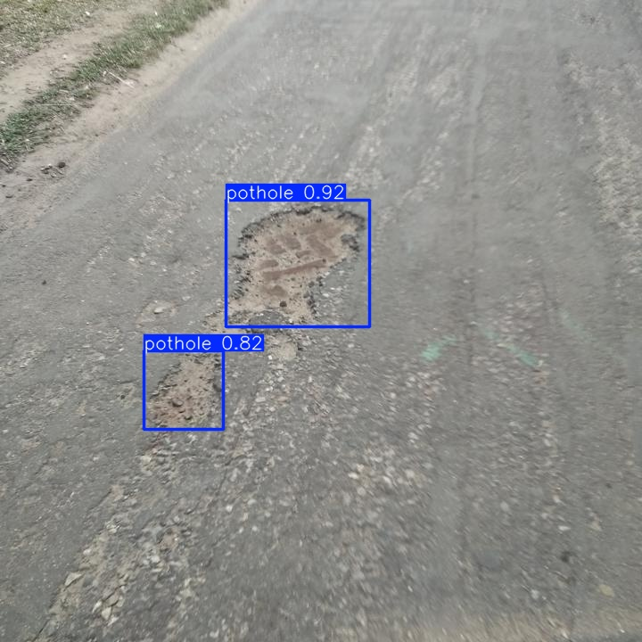
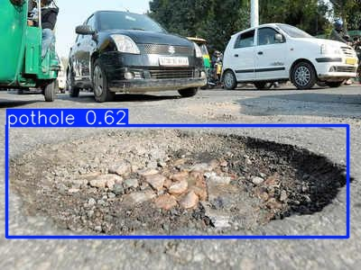
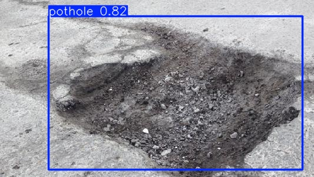
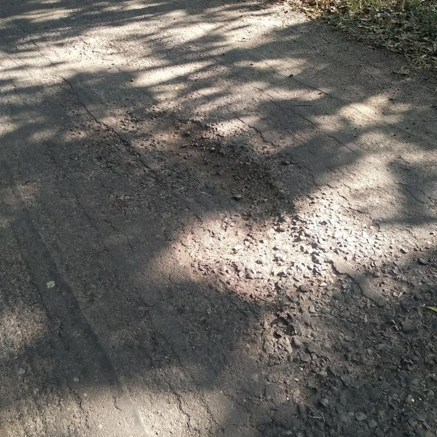
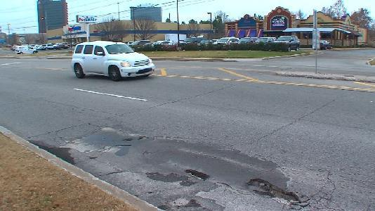
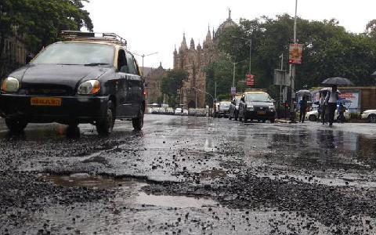

# RoadDetectAI — Pothole & Defect Detector

## Overview
RoadDetectAI is a computer vision project that uses a fine-tuned YOLOv8 model to detect potholes in road images. It displays bounding boxes and confidence scores and estimates defect severity from the percentage of image area covered by detections. A Streamlit web interface allows users to upload a road image and view the annotated result.

## Model Evaluation
Evaluated on the held-out test split containing 67 images and 154 labeled instances.

| Metric | Score |
|---|---:|
| mAP50 | 76.23% |
| mAP50-95 | 51.37% |
| Precision | 71.70% |
| Recall | 70.76% |

These are the measured evaluation results for this model version.

## Features
- Upload a road image through the Streamlit interface.
- Display predicted defect bounding boxes and confidence scores.
- Estimate severity using detected bounding-box coverage.
- View detection details and evaluation examples.

## Severity Rules
- No detections: NONE
- Coverage from 0% to 3%: LOW
- Coverage from 3% to 10%: MEDIUM
- Coverage from 10% to 20%: HIGH
- Coverage above 20%: CRITICAL

Confirm the exact boundary handling in the application code.

## Project Structure
- `app.py` — Streamlit web application
- `requirements.txt` — Python dependencies
- `README.md` — Project documentation
- `examples/` — Example predictions and failure cases
- `evaluation/` — Evaluation plots

## How to Run
1. Install Python and the dependencies listed in `requirements.txt`.
2. Make the trained YOLOv8 weights available at the model path configured in `app.py`.
3. Run `streamlit run app.py`.
4. Upload a road image to test the detector.

## Limitations
- The model was evaluated on a limited test set of 67 images.
- Predictions may miss potholes or produce false detections in unfamiliar road conditions.
- Bounding-box coverage is a rough visual estimate, not a measurement of real-world pothole size or road safety.
- Severity depends on image angle, distance, lighting, model predictions, and confidence threshold.
- More diverse data and further validation are needed before real-world municipal use.

## Examples
Add at least three reviewed successful prediction images and three confirmed failure images here before submission.

### Successful Detection Examples

The following examples demonstrate pothole detection by RoadDetectAI, including predicted bounding boxes and confidence scores.

### Failed Detection Examples

These examples illustrate possible false negatives, where the model may fail to detect a pothole present in the image. Confirm each case against the original image and its ground-truth annotations before submission.

#### Failed Example 1

**Explanation:** The model did not detect a labeled pothole at the selected confidence threshold.

#### Failed Example 2

**Explanation:** The model missed a labeled pothole, potentially due to visibility, lighting, or unclear boundaries.

#### Failed Example 3

**Explanation:** The model returned no detections for an image containing a labeled pothole.

These examples illustrate a limitation of the model: it may miss potholes under challenging image conditions.

## Deployment

**Hugging Face Spaces URL:** To be added after deployment.

## Deployment
Hugging Face Spaces URL: Add the live URL after deployment.
